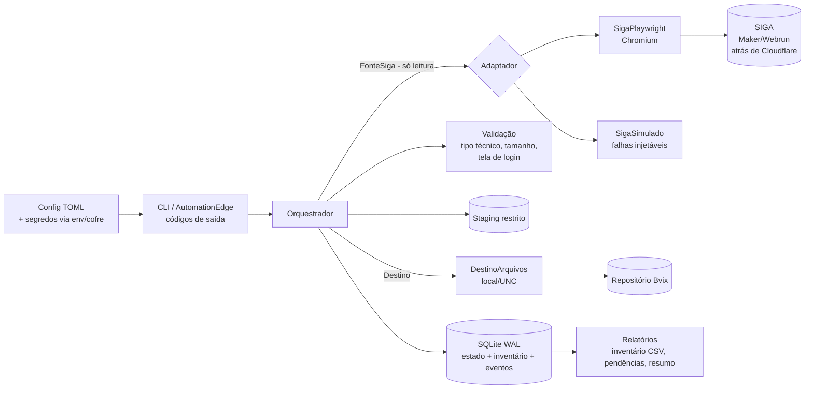
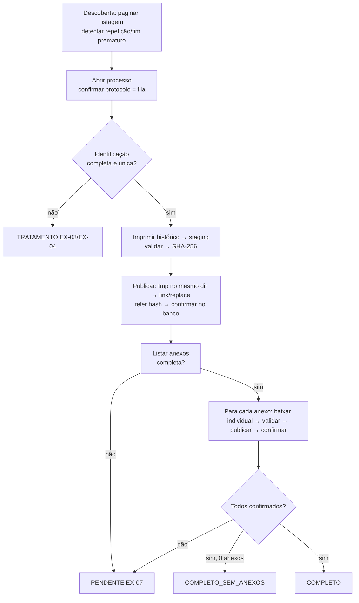

# Arquitetura — RPA de preservação de sinistros Bvix (SIGA)

Referência: PDD "Sinistros – Documentos" v0.2 (13/11/2026). O PDD diz "Rascunho; não aprovado para desenvolvimento". Este código é **núcleo + simulador**. A carga real só acontece depois do fechamento das PD e da aprovação do negócio.

Legenda: **[E]** evidência observada · **[P]** decisão proposta (a aprovar) · **[N]** pendência de negócio.

## Visão de componentes

## Fluxo por processo

## Contratos entre módulos

| Módulo | Contrato | Garantia |
|---|---|---|
| `source.FonteSiga` | `autenticar, verificar_sessao, enumerar, abrir_processo, exportar_historico, listar_anexos, baixar_anexo, encerrar` | Não existe método de escrita na origem (CA-11). |
| `destination.Destino` | `verificar(espaco)`, `hash_existente(rel)`, `publicar(arq, rel, sha)` | Nunca sobrescreve conteúdo diferente; publicação idempotente por hash; confirmação por releitura. |
| `state.Estado` | estados por execução/processo/item, versões, trilha de eventos | `confirmar_versao` grava versão e confirma o item na mesma transação. |
| `orchestrator.Orquestrador` | `preflight, descobrir, processar, executar(modo), reconciliar` | Processo só fica COMPLETO com histórico, todos os anexos e listagem completa. |
| `errors` | classes com `codigo`, `transitoria`, `sistemica` | Transitória → tentativas com espera progressiva; sistêmica → suspende. |

## Modelo de dados (SQLite)

`execucoes` (id, modo, filtros, início/fim, status, resumo) · `descoberta_paginas` (página, cursor, total, protocolos, anomalia) · `processos` (protocolo PK, id_interno, estado, identificação JSON, pasta, 1º/último erro, código, tentativas, listagem_completa) · `pastas` (pasta PK → protocolo: detecta colisão) · `itens` (chave PK, tipo, id_origem, nome original, contexto, ordinal, tamanho/data de origem, estado, ausente_na_origem) · `versoes` (chave+versão, sha256, tamanho, caminho; UNIQUE(chave, sha256)) · `eventos` (de→para, código, motivo: auditoria).

Estados de processo: `descoberto → em_andamento → completo | completo_sem_anexos | pendente | tratamento | nao_encontrado`.
Estados de item: `descoberto → em_andamento → confirmado | pendente | falho`.

## Decisões arquiteturais (ADR resumidas)

| # | Decisão | Tipo | Motivo |
|---|---|---|---|
| ADR-01 | Python 3.11+, Playwright/Chromium, modo visível até homologar | [P] | Exigência do prompt; o SIGA é web (Maker) e não há API pública conhecida. |
| ADR-02 | Seletores por placeholder/texto/ids de componente estáveis (`#tabela_localizar`); nunca `WFRInput…` nem `tmp/SIG/…` | [E] | IDs gerados pelo Maker mudam (observado 26/11). |
| ADR-03 | Listagem lida da resposta JSON de `executeRule.do`, e não do DOM | [E]+[P] | O JSON traz `idsin` (ID estável), número, placa, CPF/CNPJ e tipo de evento sem abrir formulário editável. |
| ADR-04 | Identificação vem do registro da listagem; o formulário de cadastro não é aberto | [E] | Um duplo clique no cadastro entrou em modo de edição (incidente sem dano, 26/11). |
| ADR-05 | Clique seguro com lista de controles proibidos | [P] | O perfil observado tem MOVIMENTAÇÃO e "Fechar Sinistro". |
| ADR-06 | Download individual; o lote fica desligado | [P] | RN-07: o lote falha de forma recorrente. |
| ADR-07 | Versão nova a cada hash diferente; nunca sobrescreve | [P] → PD-13 | Falta definir se metadado de impressão muda a cada extração. |
| ADR-08 | Identidade do anexo = `id_origem`, ou então processo + contexto + ordinal + nome + tamanho + data | [P] → PD-07 | Hash sozinho não identifica o item; bytes iguais continuam sendo itens distintos. |
| ADR-09 | SQLite local, executor único, trava `.lock`; backup antes de cada carga | [P] | Prompt; concorrência só com aprovação e medição de impacto. |
| ADR-10 | Pasta = padrão configurável + campos obrigatórios; ausência vai para TRATAMENTO | [N] PD-03/04 | Evidência: `tipoevento` nulo e CPF misturado com CNPJ. |
| ADR-11 | Staging fora do destino; limpeza do staging por processo | [P] | Menor exposição de dados de sinistro. |

## Riscos abertos

1. **Prazo:** desligamento em 01/12, com 3 dias úteis a partir de 26/11 (PD-11). As telas de histórico e anexos ainda não foram mapeadas.
2. **Perfil com escrita** na origem: pedir conta só de consulta (PD-01).
3. **Cloudflare**: risco de bloqueio por volume; a carga precisa de autorização formal da reguladora.
4. **Universo dividido** entre "Sinistro - Antigo" e "Sinistro - Novo" (PD-05).
5. **LGPD**: anexos podem conter dados sensíveis (sindicância, vítima). Definir acesso, retenção e base legal.
